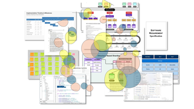
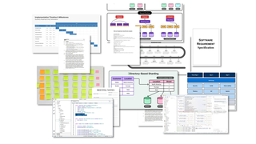
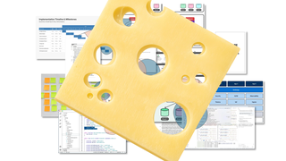
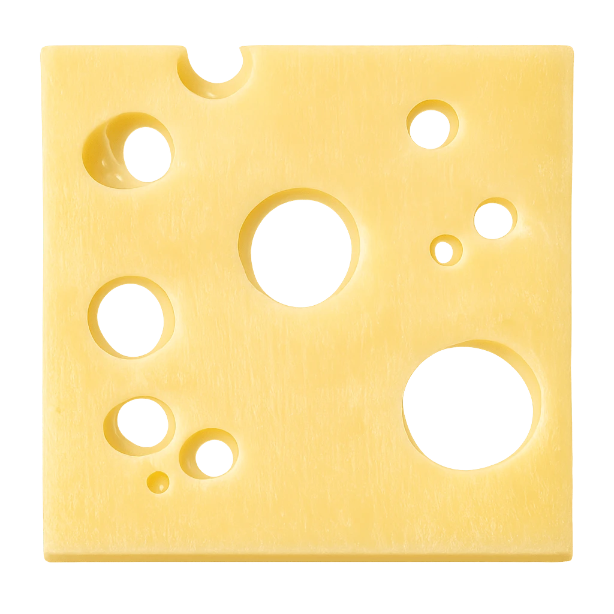
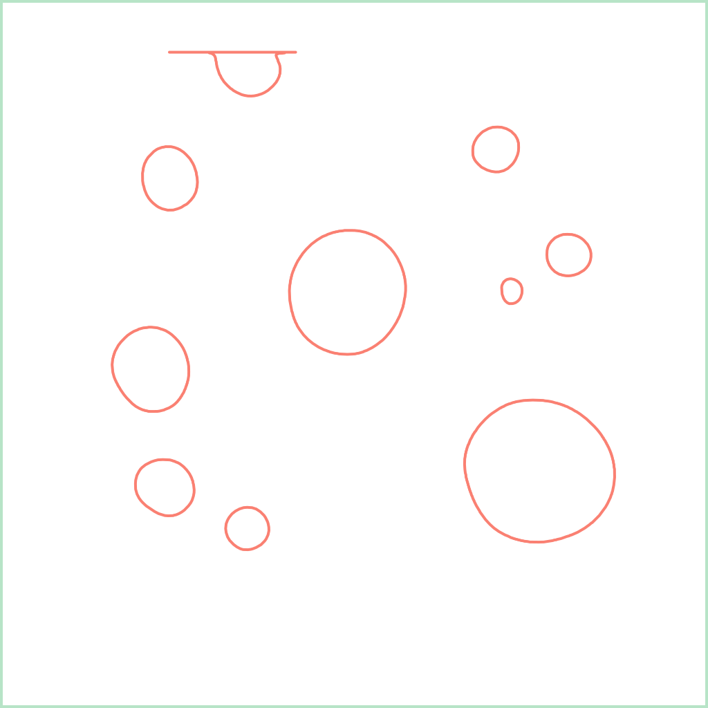

# Cheese Context



This example uses uses the holes in a slice of Swiss cheese as a visual metaphor to explain how [tunnel vision](https://en.wikipedia.org/wiki/Tunnel_vision_(metaphor)) impacts [LLM](https://en.wikipedia.org/wiki/Large_language_model) [context](https://en.wikipedia.org/wiki/Context_window) construction.

<vividly-advance message="start the demo"></vividly-advance>

## Key Elements

- animated reveal of software project artifacts
- animated cheese slice with transparent holes
- [SVG](https://en.wikipedia.org/wiki/SVG) shapes highlight areas visible through the holes

## Watch for

The animated build of the project artifact pile.



The project artifacts viewed through the slice of cheese.



Highlights of visible portions of the context after three rounds.


## Agent Contributions

**Creating Document Thumbnails.** The presentation needed ten to twenty thumbnail representations of software project artifacts - specifications, PostIt brainstorming sessions, architectural diagrams, Gantt charts, code listings, etc. They all needed a coherent visual style that was also played well with the highlighting for the holes. A few carefully worded prompts produced a large gallery of public domain thumbnails to choose from.

```prompt
I am making a powerpoint presentation and need a lot of document thumbnails for a software engineering effort. I'd like to see specifications, whiteboards, code, logs, diagrams, etc.

I would like to generate a set of visually/stylistically consistent artifacts.

- The backgrounds should be white, predominately, although light pastels like the green stripes on the printout are fine.
- Foreground text for specifications and source code should be black
- Printed architectural diagrams can use filled pastels.
- Whiteboards can use dry-erase colors and markings
- Screenshots should be light mode - not dark
- The view should be straight on so each artifact is a rectangle and the artifacts should be full bleed.
- Consider paper specifications, code listings, architectural diagrams, whiteboard diagrams and scribbles, todo lists, project timelines, outlines
- Since they are thumbnails, use a variety of font sizes and paragraph block sizes
```

**Creating Swiss Cheese Effect.** An image generation model was used to generate a transparent [PNG](https://en.wikipedia.org/wiki/SVG) image of a slice of Swiss cheese with transparent holes. Another model traced the holes and generated [SVG](https://en.wikipedia.org/wiki/SVG) paths for the holes. Then a coding agent stitched it all together.




```prompt
Generate me a transparent PNG of a slice of Swiss cheese. The slice should be square and viewed from the top. I want a transparent background so I can use the slice as an overlay in a PowerPoint slide. For that use I want to be able to see through the holes to the content below the slice
```

```prompt
Please generate me an SVG file with just the exact holes in the cheese, including the bite at the top, with perfect alignment to the png.
```


<vividly-advance message="start the demo"></vividly-advance>
