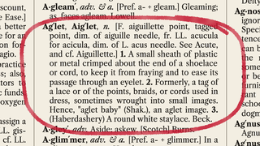
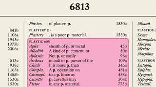
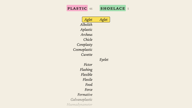
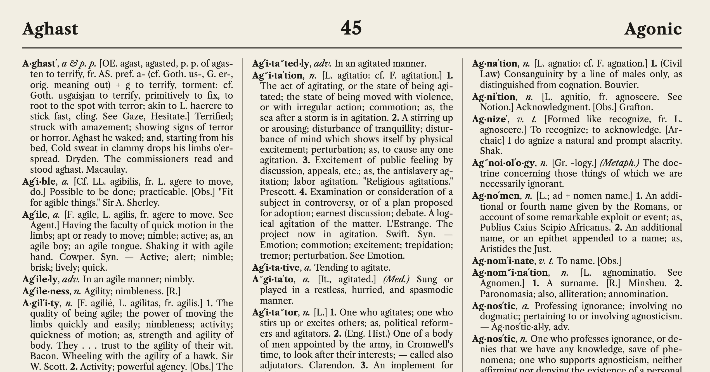

# Inverted

This example uses the notion of a [concorodance](https://en.wikipedia.org/wiki/Concordance_(publishing)) to explain the concept of an [inverted index](https://en.wikipedia.org/wiki/Inverted_index).

<vividly-advance message="start the demo"></vividly-advance>

## Key Elements

This presentation uses 
- rich visuals of shoe laces and printed dictionary pages to enhance story telling
- cinematic zoom and pan, along with various highlighting techniques to focus the viewer's attention
- animations to demonstrate algorithm mechanics

## Watch for

Cinematic zoom and pan during the explanation of a concordance.

Animated description of merge algorithm

Dictionary zoom and highlight - a red marker circles the word, _aglet_, as the camera zooms in.

## Agent Contributions

**Generate for the story, rather than search for a substitute.**

Finding the right image can take longer than building the slide—and the image you need may not exist. AI image generation lets you iterate toward the subject, composition, and aesthetic your explanation requires.

With a suitable generator and applicable terms, this can also avoid stock-image licensing fees and reduce time spent managing image-library accounts, permissions, attribution requirements, and asset-specific licenses. For open-source projects, that can make useful visuals easier to share and maintain.

The goal is imagery you can confidently redistribute, not an assumption that every generated image is unrestricted. Use original, generic subjects; avoid recognizable protected material and real-person likenesses; review the output; and record its provenance and applicable terms.

The presentation needed an open source dictionary and concordance. The AI agent built one from the public domain Webster’s Revised Unabridged Dictionary (1913).

<vividly-advance message="start the demo"></vividly-advance>
