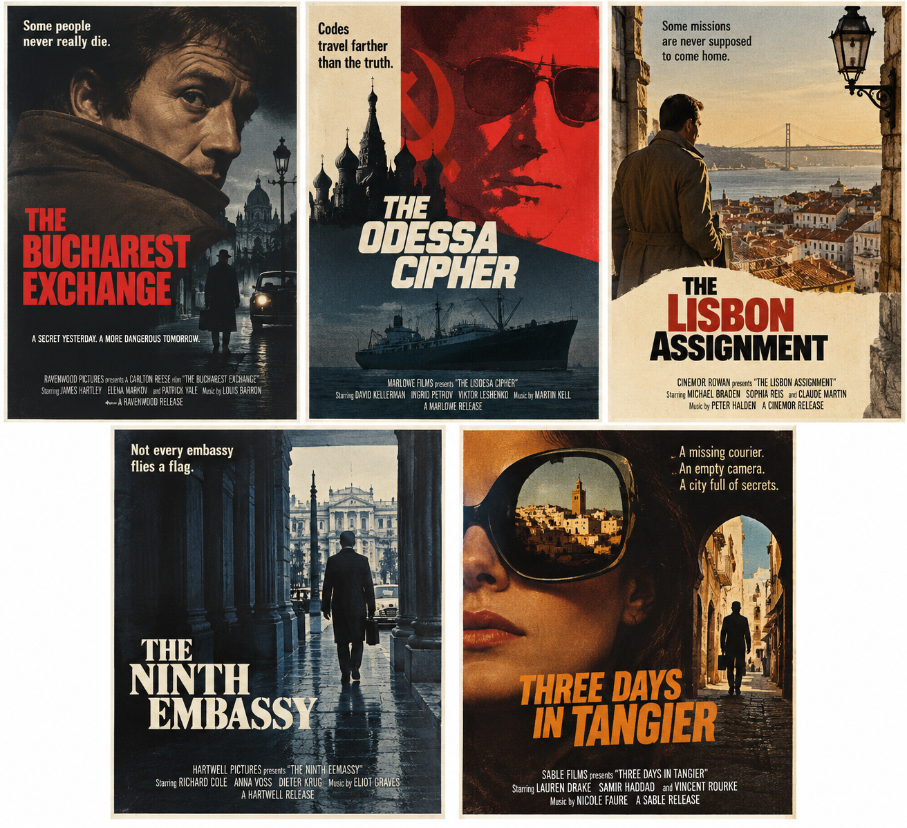
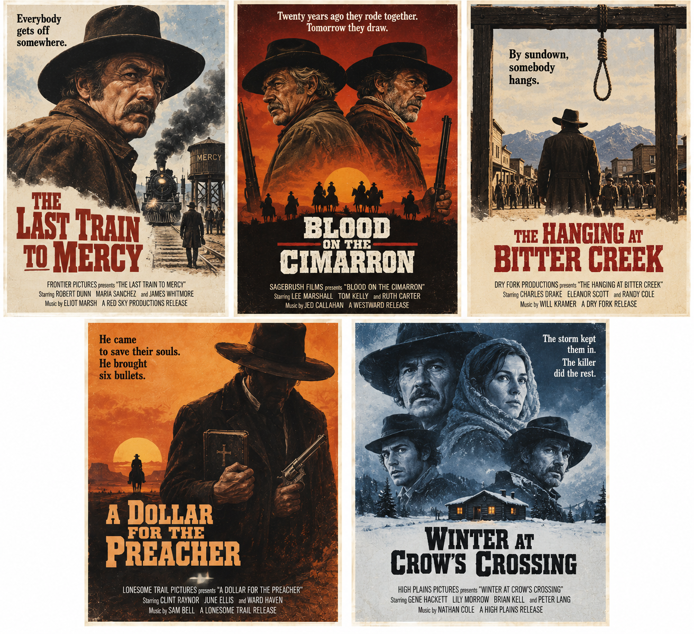
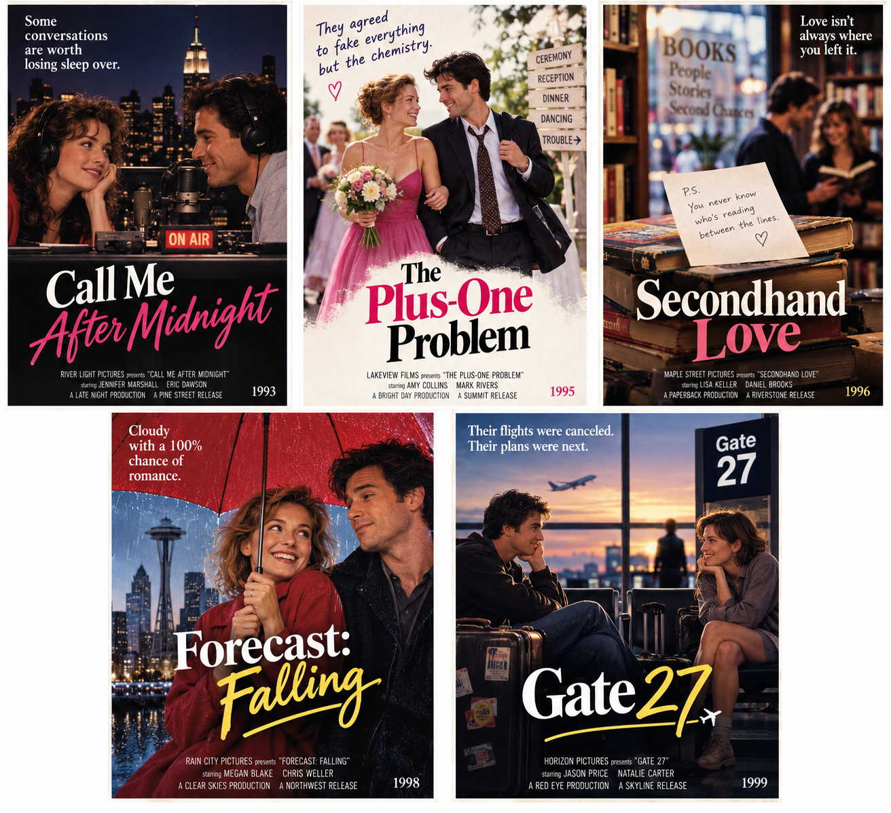

# Movie Poster Development

I was using movie posters to illustrate a concept and didn't want to use copyrighted material, so I asked an agent to make the posters.

To begin the experiment, I used a two step process - first generate fictitious synopses, and then from the synopses, generate the posters. 

I started with spy thrillers:

<!--
Narration stays outside the conversation panels as ordinary Markdown.
Use a Designer label and a prompt fence for instructions.
Place an Agent label before each conversation-response section, with blank lines
around its Markdown content so lists, paragraphs, and images still render.
Images belong in ./assets/ and display at 80% of the response width.
-->

<p class="conversation-speaker conversation-speaker--designer">Designer</p>

```prompt
Help me brainstorm 5 fictional movie titles from the spy genre in the 1970s
```

<p class="conversation-speaker">Agent</p>

<section class="conversation-response" aria-label="Agent response">

Here are five that aim for the slightly paranoid, international, Cold War feel of a 1970s spy thriller:

1. **The Bucharest Exchange** — A burned-out British intelligence officer discovers that a routine prisoner swap is actually moving someone who officially died six years earlier.

2. **The Odessa Cipher** — A stolen Soviet codebook, a Black Sea freighter, and three intelligence services pursuing a cipher nobody is supposed to know exists.

3. **The Lisbon Assignment** — An American operative sent to quietly retrieve a defecting diplomat realizes his own agency would prefer that neither of them return.

4. **The Ninth Embassy** — After an attaché is murdered in Vienna, an intelligence analyst discovers a clandestine diplomatic mission operating outside both East and West.

5. **Three Days in Tangier** — A courier carrying a roll of microfilm disappears in Morocco, leaving behind only a hotel key, an empty camera, and a train ticket to Madrid.

For a **1973–1977 movie-poster vibe**, I especially like **The Bucharest Exchange** and **The Lisbon Assignment**. They sound plausibly like movies you might find between *The Day of the Jackal* and *Three Days of the Condor* in an old newspaper listing.

</section>

The synopses looked pretty good, so I continued on to the posters:

<p class="conversation-speaker conversation-speaker--designer">Designer</p>

```prompt
Generate me some movie poster thumbnails based on these fictitious films
```

<p class="conversation-speaker">Agent</p>

<section class="conversation-response" aria-label="Agent response">



</section>

The Spy Thrillers looked great, so I tried Westerns:

<p class="conversation-speaker conversation-speaker--designer">Designer</p>

```prompt
Now come up with 5 western movie ideas.
```

<p class="conversation-speaker">Agent</p>

<section class="conversation-response" aria-label="Agent response">

Here are five designed to feel like **real 1970s Westerns**—a little revisionist, morally ambiguous, dusty, and increasingly strange as the decade progresses.

1. **The Last Train to Mercy** — 1971. A disgraced railroad detective boards the final passenger train through a dying Arizona territory town, hunting a fugitive who may be the only innocent man aboard. *“Everybody gets off somewhere.”*

2. **Blood on the Cimarron** — 1973. Two aging gunfighters, once partners, find themselves hired by opposite sides of a vicious range war in New Mexico. Neither realizes who he's fighting until the first shots have already been fired. *“Twenty years ago they rode together. Tomorrow they draw.”*

3. **The Hanging at Bitter Creek** — 1974. A circuit judge arrives in an isolated Wyoming settlement to preside over a hanging—only to discover that nearly everyone in town has a different reason for wanting the prisoner dead. *“By sundown, somebody hangs.”*

4. **A Dollar for the Preacher** — 1976. A mysterious itinerant preacher crosses the Texas border with a Bible, a battered revolver, and an uncanny talent for finding men who disappeared during the Civil War. Nobody knows whether he's seeking justice, revenge, or absolution. *“He came to save their souls. He brought six bullets.”*

5. **Winter at Crow’s Crossing** — 1978. A wounded outlaw, a widowed rancher, a young cavalry deserter, and a bounty hunter become snowbound together in an abandoned Montana stagecoach station. By morning, one of them has been murdered—and the horses are gone. *“The storm kept them in. The killer did the rest.”*

For posters, **A Dollar for the Preacher** practically demands the classic 1970s illustrated one-sheet treatment: tiny lone rider beneath an enormous sky, black silhouette of a cross/revolver, burnt orange sunset, and big distressed serif lettering. **Winter at Crow’s Crossing** could go in the opposite direction—stark blue-white snow, four faces, one black cabin, almost a Western crossed with a murder mystery.

</section>

<p class="conversation-speaker conversation-speaker--designer">Designer</p>

```prompt
Please generate poster thumbnails
```

<p class="conversation-speaker">Agent</p>

<section class="conversation-response" aria-label="Agent response">



</section>

And then I tried Rom Coms:

<p class="conversation-speaker conversation-speaker--designer">Designer</p>

```prompt
Now 5 rom com ideas from the 90s
```

<p class="conversation-speaker">Agent</p>

<section class="conversation-response" aria-label="Agent response">

Absolutely—going for the **peak 1990s rom-com universe**: bookstores, radio stations, mistaken identities, impossibly nice Manhattan apartments, and jobs that somehow leave plenty of time for romance.

1. **Call Me After Midnight** — 1993. A late-night radio producer accidentally gets patched through to a sarcastic insomniac who called the station to complain. Their on-air argument becomes so popular that her boss turns it into a nightly feature. They fall for each other without realizing they've already met—and can't stand each other—in real life. *“Some conversations are worth losing sleep over.”*

2. **The Plus-One Problem** — 1995. After telling her family she has a serious boyfriend, a Chicago magazine editor persuades the charming photographer she just fired to accompany her to her sister's wedding. Three days, one hotel room mix-up, two exes, and an increasingly inconvenient amount of genuine affection follow. *“They agreed to fake everything but the chemistry.”*

3. **Secondhand Love** — 1996. The owner of a tiny Manhattan used bookstore keeps finding handwritten love notes tucked into books donated by the same mysterious woman. He begins writing replies and slipping them back onto the shelves—while unknowingly dating her extremely practical roommate. *“Love isn't always where you left it.”*

4. **Forecast: Falling** — 1998. A relentlessly cheerful Seattle TV meteorologist and the cynical newspaper columnist assigned to profile her make a bet: she has one month to prove that Seattle isn't as miserable as he claims. Naturally, it rains for 27 straight days. *“Cloudy with a 100% chance of romance.”*

5. **Gate 27** — 1999. Two strangers stranded overnight at an airport after their flights are canceled spend twelve hours wandering empty terminals, stealing cookies from an airline lounge, and telling each other things they've never told anyone. In the morning, they're flying to opposite sides of the country—to marry other people. *“Their flights were canceled. Their plans were next.”*

</section>

<p class="conversation-speaker conversation-speaker--designer">Designer</p>

```prompt
And poster thumbnails
```

<p class="conversation-speaker">Agent</p>

<section class="conversation-response" aria-label="Agent response">



</section>

At this point is was clear that the concept would work, but I wanted more posters that I could generate manually, so I asked the agent to produce a script.

<p class="conversation-speaker conversation-speaker--designer">Designer</p>

````prompt
I'd like to create a python script to use ChatGPT to generate fictitious movie poster thumbnails. 

The app will take as input a yaml file with two sections:

- settings for the size image to generate and the aspect ratio to crop to and the dimensions of the final scaled downthumbnail, and the folder path for original generated images and thumbnails.l
- an array of movie objects that specify the title and synopsis. 

The app will then

- Generate filesystem names for each image. So, for instance "The Last Train to Mercy" might become "the-last-train-to-mercy.jpg". Add these names to the yaml file for each entry without a name.
- For each image that doesn't already exist on disk, generate it using the technique outlined above, getting the API key from an environment variable. Save the original image.
- Use python to crop and then scale the image to generate a thumbnail.
- Pause briefly before doing next image to avoid throttling.

Please start by making a yaml file, based on the following text:

```
- The Bucharest Exchange — A burned-out British intelligence officer discovers that a routine prisoner swap is actually moving someone who officially died six years earlier.
- The Odessa Cipher — A stolen Soviet codebook, a Black Sea freighter, and three intelligence services pursuing a cipher nobody is supposed to know exists.
- The Lisbon Assignment — An American operative sent to quietly retrieve a defecting diplomat realizes his own agency would prefer that neither of them return.
- The Ninth Embassy — After an attaché is murdered in Vienna, an intelligence analyst discovers a clandestine diplomatic mission operating outside both East and West.
- Three Days in Tangier — A courier carrying a roll of microfilm disappears in Morocco, leaving behind only a hotel key, an empty camera, and a train ticket to Madrid.

```

Then draft the python program.
````
