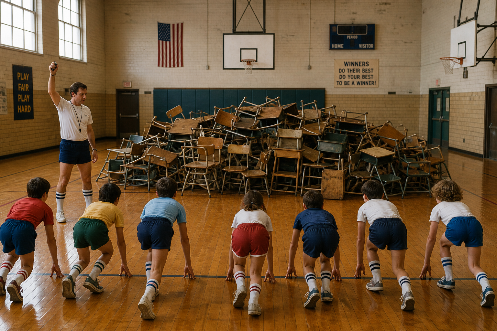
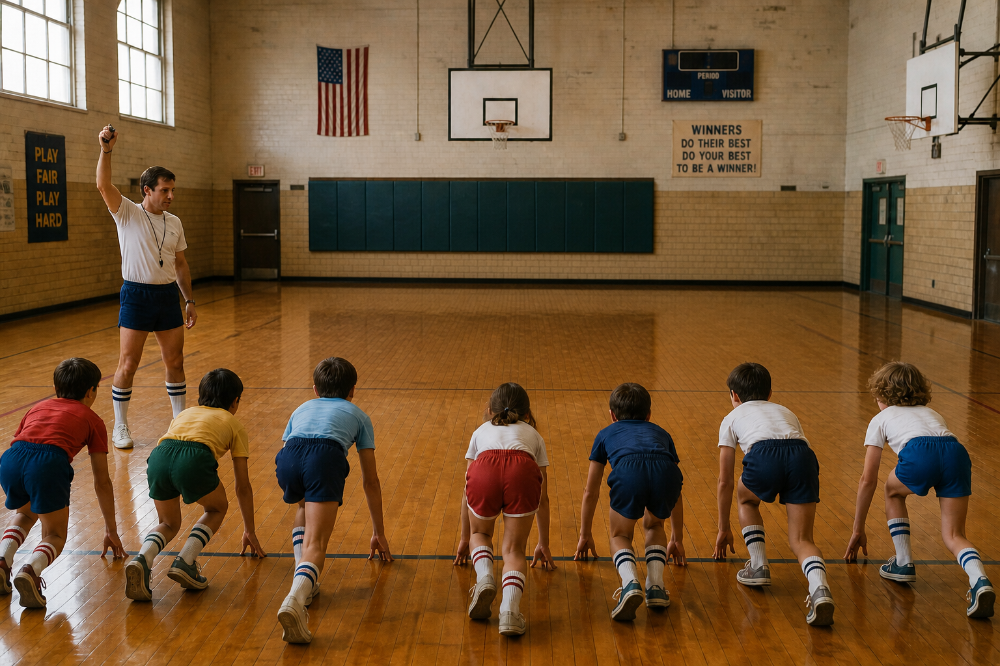

# Prompting Image Builds

Here is an example of using a model to create two images that can be used as a build sequence.

<div class="image-build-previews">
<section class="image-build-example" aria-label="First prompt and image">

<p class="conversation-speaker conversation-speaker--designer">Prompt for image 1</p>

```prompt
Make me a picture of an old elementary school gymnasium, hardwood floors, basketball hoops. A group of kids are about to start a race from one end to the other, but there is a huge pile of old schoolroom desks and chairs in the way. The gym teacher is about to signal the start of the race.
```

  <figure>
    
    <figcaption>Image 1: Obstacles in the way</figcaption>
  </figure>

</section>
<section class="image-build-example" aria-label="Second prompt and image">

<p class="conversation-speaker conversation-speaker--designer">Prompt for image 2</p>

```prompt
Can you make the exact same gym with no chairs and desks? I want to flip from one to the other seamlessly.
```

  <figure>
    
    <figcaption>Image 2: A clear path</figcaption>
  </figure>

</section>
</div>

<p class="image-build-next">Let's see what it looks like.</p>
