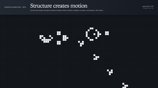
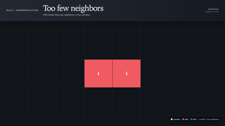
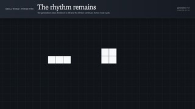
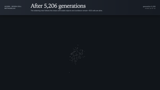

# Conway's Game of Life

This example shows how four local rules can create stable structures, oscillators, moving patterns, and surprising complexity in [Conway's Game of Life](https://en.wikipedia.org/wiki/Conway%27s_Game_of_Life).

<vividly-advance message="start the demo"></vividly-advance>

## Key Elements

- step-by-step visual explanations of all four rules
- animated transitions between generations
- cinematic pan and zoom across patterns ranging from a few cells to a world thousands of cells wide
- a canvas renderer that computes and displays real Game of Life generations

## Watch for

The opening examples annotate each cell's neighbor count and use color to distinguish cells that survive, die, or are born.

The Gosper glider gun remains in place while producing gliders that travel away from it.

The seven-cell Acorn expands through 5,206 generations before settling into a 633-cell legacy.

## Agent Contributions

The coding agent implemented the Game of Life engine and canvas renderer, including efficient generation caching for patterns that run for thousands of turns.

It also created deterministic step states for direct and reverse navigation, animated generation changes, viewport interpolation, rule annotations, and accessible text descriptions of each board.

<vividly-advance message="start the demo"></vividly-advance>
