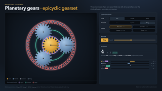

# Why Vividly?

Vividly introduces a new paradigm for creating richly animated, interactive, code-based presentations targeted at educators, engineers, scientists and business leaders who bring insights in a rapidly evolving world of complex systems and ideas.

> Vividly helps engineers and scientists quickly and easily author interactive, animated, algorithm-based presentations that include professional visuals and narration. It does this by providing a well-documented framework for stitching modular agent-authored presentation segments into complete presentations.

Authoring in Vividly is always a partnership with coding agents. Human experts provide the vision and ideas and agents implement the presentation experience - anything from a simple slide with a bulleted list, to a layered multi-part build, to a complex interactive simulation.

Vividly provides the framework and API definitions that make it possible to combine modular agent-authored slides into seamless presentations that can be shared and remixed with other presentations. 

Vividly focuses on simplifying the authoring experience. Its key principles are
- relying on coding agents to implement slide visuals and animations
- eliminating complex toolchains
- eliminating build systems - the agent produces the files served by the site

Vividly presentations are standalone [single page web apps (SPAs)](https://en.wikipedia.org/wiki/Single-page_application)). 
Since Vividly presentations are just web apps, anything that runs in the the browser can be incorporated into your presentation. This includes
- intricately choreographed animatations
- complex, layered builds
- cinematic zoom and pan through many layers of abstraction
- interactive simulations
- 3D visualizations
- live charts
- dashboards
- workflows

## Vividly Scenarios

- **Complex Layered Build Slides** - these are complex diagrams presented to th audience bit-by-bit over time. In a typical knowledge worker presentation tool, authors must carefully design the final state of the diagram, and then work backwards, either using animations to reveal portions of the diagram over time, or by copying the final slide and deleting elements. Either way, creating these slides is challenging and error-prone. Vividly uses agent-authored code to add elements to the slide as the presentation progresses. Changing a font or text or box in Vividly does not require editing each of the steps of the diagram.

- **Explaining with Animation** - complex ideas are often best illustrated with animations. Vividly excels at creating animations because it does all of the hard work of adjusting timing, keyframes, motion paths and other characteristics. If a needed feature doesn't exists, the coding agent will just implement it. Traditional slide authoring applications struggle with making animations look good because their path editing tools can't easily align shapes. In Vividly presentations, the coding agent will ensure perfect shape alignment with no visual artifacts.

- **Interactive Charts** - Vividly presentations are inherently interactive so they can include live, interactive charts to facilitate audience drill downs, zooms and pans and "what if" discussions during the presentation. Most traditional presentation authoring tools are limited to static charts. 
- **Non-linear Navigation** - Vividly's interactive nature is well-suited for in-presentation UI to explore sidebars, drill downs, and choose-your-own-adventure style exploration.
- **Interactive Simulations** - Vividly presentations are made of code, so it is easy to incorporate live, running simulations with control knobs. You don't have to tell your audience - you can show them.

- **Dashboards** - Vividly's inherent interactivity and use of code makes it easy to include live dashboards in a presentation, blurring the line between a simple presentation and a tool to run your business.
- **Workflows** - Vividly's non-linear navigation and use of code makes it easy to implement process workflows, again blurring the line between a presentation and a business tool or employee training delivery platform.
- **Annotated Terminal Sessions** - Vividly provides a built-in control for replaying console sessions with explanatory annotations and the ability to time-warp through long sessions to interesting points.
- **Annotated Markdown Files** - Vividly provides a built-in control for creating tours of annotated markdown files. The presenter can manually scroll through the file or jump from annotation to annotation.
- **Syntax Highlighting** - Vividly has the ability to apply syntax highlighting, line numbers and annotations to presented source code.
- **Sharing** - Vividly presentations are single page web apps that follow a specific design pattern. This means you can point your coding agent at another Vividly presentation and ask it to import a passage and make it conform to the visual styling of your own presentation. Individual authors and combine and recombine slides and passages from their own inventory while groups of authors can share amongst themselves.
- **Extending Vividly** - wish Vividly had a particular feature? Ask your coding agent to implement it in the Vividly runtime that is embedded in your presentation. If the feature proves valuable, ask your coding agent to do a three-way merge of your feature with the Vividly codebase and contribute it back. Even if you don't contribute your enhancements to the published Vividly package, you can still make them available to any coding agent that can access your presentation.
- **Your Briefcase** - implement all your presentations with Vividly and host them publicly on GitHub pages or privately on Azure Static Websites and always have your "briefcase" of slides and presentations available to combine and recombined with each audience. Keep your entire catalog at your fingertips for use in the Q&A session when someone wants to dive deeper or discuss a related topic.
- **Remixing Presentations** 

## Q&A

- Why use Vividly when I can just ask a coding agent to make me a presentation?
- Couldn't I ask my agent make me a deck in one of the industry standard presentation applications?
- What if I need a feature that is not in Vividly?
