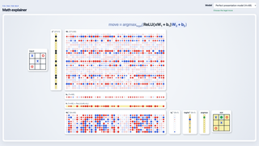
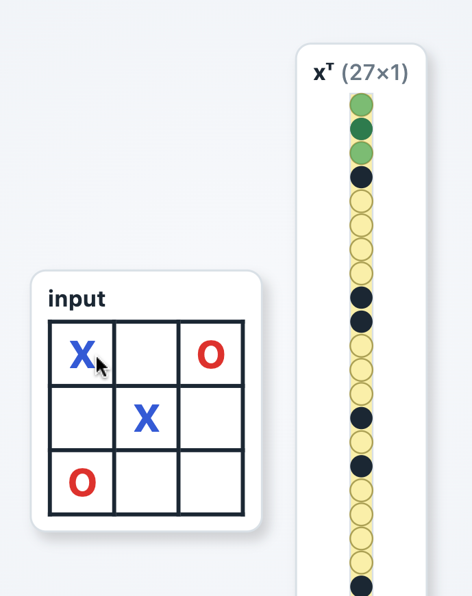
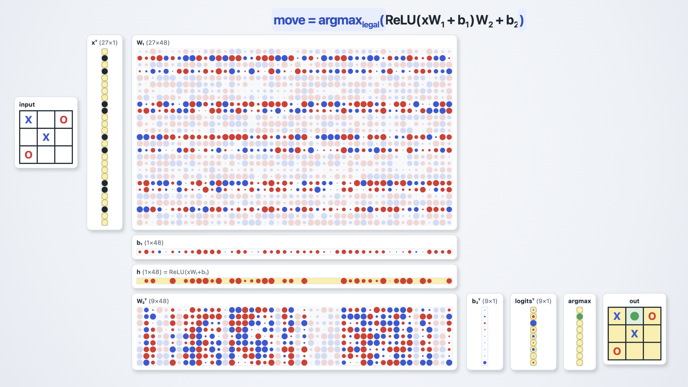

# Tic-Tac-Toe



This example demonstrates how a very small [Multilayer Perceptron](https://en.wikipedia.org/wiki/Multilayer_perceptron) can be trained and used to play [Tic-Tac-Toe](https://en.wikipedia.org/wiki/Tic-tac-toe).

<vividly-advance message="start the demo"></vividly-advance>

## Key Elements

The presentation incorporates a number of elements that would be hard or impossible to do in a knowledge worker presentation application:
- interactivity, from simple mouseover highlighting to illustrate relationships between elements of the system, to actually playing a game, to configuring and running the training algorithm
- complex builds that present a large concept by introducing smaller concepts, one at a time
- animations that help show the flow of computations
- graphical visualization for real data, in this case, the sizes and polarity of the trained weights and biases
- cinematic zoom and pan

## Watch for

The presentation starts out illustrating the mapping from the input game board to its encoding as a [one-hot vector](https://en.wikipedia.org/wiki/One-hot). During this first step you can
- point the mouse at squared on the game board and see the corresponding one-hot bits highlighted in green
- click on a game board square to toggle between empty, X, and O.
- advance to the next slide (right arrow or space bar) and see viewport smoothly zoom and pan to make room for the rest of the diagram.




A rich step-by-step build of a visualization of the real, running multi-layer perceptron that plays Tic Tac Toe. 



After building and explaining the system elements one-by-one, the presentation concludes with a playable system and then a model training demonstration.

## Agent Contributions

The coding agent 

- implemented the multilayer perceptron with [ReLU](https://en.wikipedia.org/wiki/Rectified_linear_unit) activation, the inference computation, and training using the [Adam](https://en.wikipedia.org/wiki/Stochastic_gradient_descent#Adam) algorithm for stochastic gradient descent. All of this runs in pure javascript in the web page.

- implemented the [Minimax/negamax](https://en.wikipedia.org/wiki/Negamax) Tic-Tac-Toe algorithm to generate provably perfect moves to be used for training.

- performed a binary search of model sizes find the smallest model that could be trained for perfect play. Making the model smaller made the screen less crowded, allowing for larger, more readable graphics

- make a number of mockups of different layouts and visual treatments

- implemented a viewport for cinematic zooms and pans

Creating this presentation took hundreds of turns in GitHub Copilot, but it started with a discussion of the feasibility of tic-tac-toe for explaining multi-layer perceptrons.

```prompt
What is the smallest state machine that can play tic tac toe?

I want any player, any turn, perfect play. I am assuming there are very short algorithms for this so we could open the discussions to algorithms as well as state machines.

I want to use this for a presentation on multi-layer perceptrons. I'd like to manually or with a deterministic algorithm create weights so that the model provably runs the exact algorithm. Then I want to see if I can generate the same behavior via training and I would like to verify both approaches on all legal boards.
```

<vividly-advance message="start the demo"></vividly-advance>
